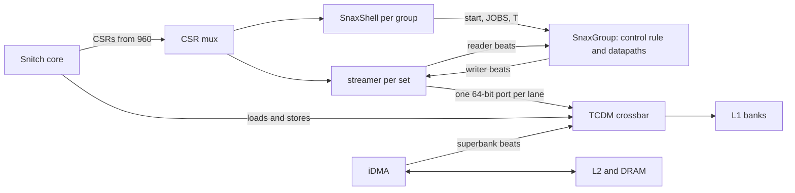

# snax-gvsoc

SNAX-GVSoC is a GVSoC model of the SNAX cluster ([snax_cluster](https://github.com/KULeuven-MICAS/snax_cluster)) in which a Snitch core runs the real program. It is [SNAX-FORGE](https://github.com/KULeuven-MICAS/snax-forge)'s model, checked against snax_cluster's RTL by running one ELF on both.

It is a detached copy of [GVSoC](https://github.com/gvsoc/gvsoc) at `93cedc4`. `UPSTREAM.md` lists the upstream commits, the license and every upstream file we changed. GVSoC's own docs: [gvsoc.readthedocs.io](https://gvsoc.readthedocs.io/en/latest/) and [gvsoc-developer.readthedocs.io](https://gvsoc-developer.readthedocs.io/en/latest/).

## The SNAX parts

The core configures an accelerator through CSRs; the streamer moves its data between the L1 banks and the accelerator's ports.

- A set whose groups share movers puts a `SnaxPortMux` between the streamer and the groups.
- Every number (lanes, widths, timing, CSRs) is read from the design point's files at run time, so a new design point compiles nothing.

## Layout

| Path | What |
|---|---|
| `core/`, `engine/`, `pulp/`, `gvrun/`, ... | GVSoC, as upstream has it |
| `snax/` | the SNAX components and the `snax_hjson` target, which builds any SNAX cluster from its hjson |
| `forge/` | snax-forge's generated design points, one folder each, checked in as fixtures (`forge/README.md`) |
| `sw/` | a pinned copy of snax_cluster's software (`sw/README.md`) and our programs in `sw/apps/` |
| `tests/snax/` | the regression, the testbenches and the Python unit tests |
| `docs/` | `TOOL.md` (the commands), `EVENTS.md` (what a run writes), `notes/NOTES.md` (what was measured and still holds) |

## Getting started

- Everything runs in snax-forge's image, `ghcr.io/kuleuven-micas/snax-forge:main`; `docs/TOOL.md` has the commands with the lines to check.
- Usually you don't run this repository by hand: snax-forge's `pixi run flow` builds it and runs a design point on it.
- CI (`.github/workflows/ci.yml`, same image) builds GVSoC, runs the unit tests and `make regress` on every pull request and push to main.

## Comparing with the RTL

The regression checks that each program finishes. Cycles are compared with snax_cluster's RTL by snax-forge's local check (its `docs/TOOL.md`), which runs each bundle on the RTL and on SNAX-GVSoC; `docs/notes/NOTES.md` has what was measured.

## License

Apache 2.0, see `LICENSE` and `UPSTREAM.md`.
