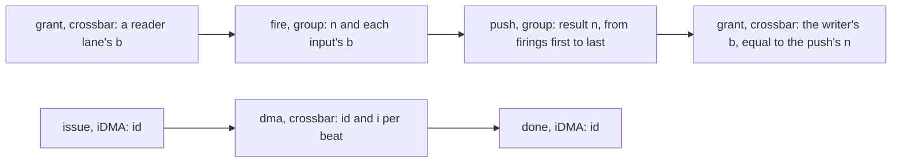

# SNAX-GVSoC's events

What SNAX-GVSoC's SNAX components write about a run, line by line: for snax-forge's converter (`snax_forge/run/`) and for anyone reading a run by hand. The grammar is this repository's; snax-forge renames it and never recounts.

## Traces and levels

Each SNAX component has four GVSoC traces (`vp::Trace`, `snax/snax_events.hpp`), named:

| Trace | Holds | On at |
|---|---|---|
| `summary` | counters: per run of a unit or streamer at its end, the others' at the end of the simulation | every level, `off` included |
| `events` | what happens once per task: starts, dones, CSR accesses, waits, function entries, DMA copies | `task` |
| `beats` | one line per beat: grants, DMA beats and bursts, firings, pushes; one per change of a unit's or mover's cycle class | `beat` |
| `stalls` | one line per refused request and per change of a queue's count | `stall` |

The levels are cumulative, each the one before plus a trace: `off` (`summary`) < `task` (+ `events`) < `beat` (+ `beats`) < `stall` (+ `stalls`) < `finegrained` (+ GVSoC's own `pe<i>/insn`, the instruction trace).

- A level is the set of trace names that are on, given to `gvrun` as one `--trace` regex per name.
- All of them name one file, so every component's lines come in the order the simulation writes them:

    gvrun ... --trace='/summary$:RUN/events.log' --trace='/events$:RUN/events.log' run

- `--trace-level` is not used: every line here is written at GVSoC's default level.
- With these traces off, a run is the same as without them.

**Sources.** The crossbar writes the `beats` and `stalls` lines of every L1 access, so a path regex cannot tell the streamer's from the cores'. Its property `trace_inputs` picks the inputs instead:

- It is a gvrun parameter (`--param chip/soc/cluster_0/tcdm/snax_xbar/trace_inputs=...`), so nothing is rebuilt.
- Its value is a list joined by `,`: input names as the summary's `input` lines give them (or indices), and `dma` for the DMA port. `default`, the value when none is given, is the SNAX ports and the DMA; an unknown name is fatal.
- The cores and AXI are written only when named.
- It filters only the `beats` and `stalls` lines and the `insn` traces (one regex per core); `summary` and `events` are always whole.
- A run's window (its `main`) is not known here ahead of time, so boot's lines are written too; the converter drops them.

**Ids, not order.** Every line has its own `<cycle>`; ids say which other line it links to, so nothing reading them counts lines by order or rate:

- a streamer beat is (mover, `b`): a reader's beats numbered in its AGU's order from 0 in each run, a writer's in the order the unit hands them over; a reader with a repeat (temporal stride 0 on loop 0) hands one beat out T times, so several firings name one `b`;
- a firing is `n`, its index in the run; a result is `n`, its index among the run's results, equal to the writer's `b` it becomes;
- a DMA beat on L1 is (copy `id`, `i`), `i` its index within the copy.

The id travels with the request: the iDMA's TCDM backend puts the copy's `id`, `i` and `l2` in `IoReq` argument slots for the crossbar's `dma` line; the streamer puts `b` on its requests, and returns it to the unit with the beat it hands over.

## Lines

GVSoC writes a header before each line, `<ps>: <cycles>: [<path>] `, with ANSI colour codes around the path; `<path>` is the component's path, then `/` and the trace's name. The converter keeps the component's path and ignores the rest of the header. The line itself is

    <cycle> <kind> <key>=<value> ...

- `<cycle>` is a cycle of the component's own clock: the cycle the line is about (below, per kind).
- Most lines are written in that cycle. A `poll`, a `barrier`, a held `csr` write, a single `csr` read, a `fifo` and a mover's `class` for cycles the streamer slept through are written later, once known, so sort by `<cycle>` for time order. Lines of one cycle are in simulation order.
- A value is a decimal integer; a hexadecimal one with `0x` (addresses, `pc`, `csr`, and every `value`: bank words, each the bytes it covers, little-endian); a list of integers joined by `,`; or a name.
- Every line ends in a newline.

## Components

The paths are those of `snax_hjson`'s cluster (`/chip/soc/cluster_0/...`); `snax_acc<i>` is core `i`'s accelerator. Its components follow its `accelerator.json`, one `SnaxGroup` per group, named by `snax_accelerator.py`'s `component_names`:

| Accelerator | Group | Its shell |
|---|---|---|
| one group of one unit (most `forge/` fixtures) | `snax_acc<i>/unit` | `snax_acc<i>/shell` |
| several groups of one unit each | `snax_acc<i>/unit_<unit>` | `snax_acc<i>/shell_<group>` |
| a linked group (units joined by links) | `snax_acc<i>/group_<group>` | `snax_acc<i>/shell_<group>` |

Each group has the traces below, at its boundary; the shell has no trace of its own.

### Group (`snax_acc<i>/unit`, `snax_acc<i>/unit_<unit>`, `snax_acc<i>/group_<group>`; `snax/snax_group.cpp`)

For a linked group:

- `fire` lines are its head unit's firings, with the head's outer inputs;
- `push` lines are the last unit's results, `first` and `last` the head's firings each one folds;
- `count` and `firings` are the head's, and `rate` is the head's firings per result of the last unit.

| Trace | Kind | Cycle | Fields |
|---|---|---|---|
| `events` | `start` | the cycle `s` a start is taken (busy from `s + 1`) | `count` (the run's firings, JOBS * JOB_BEATS; a linked group's head's), `rate` (its JOB_BEATS: a result every `rate`-th firing; 1 without one) |
| `events` | `done` | the run's last busy cycle `E` (idle from `E + 1`) | `firings`; `first` and `last`, the cycles of its first and last firing |
| `summary` | `run` | `E` | `index` (from 0), `firings`, `busy`, `stall_in`, `stall_out`, `flush` (they add up to `E - s`) |
| `beats` | `fire` | the firing | `n` (its index in the run), `b` (the beat taken from each input port, port order; a fold's seed, taken on its job's first firing only, -1 on the others), `value` (each input port's beat words, port order, flat; a seed not taken, its last) |
| `beats` | `push` | the push | `n` (its index among the run's results), `first`, `last` (the firings it folds; equal at rate 1), `value` (the output beat's words) |
| `beats` | `class` | the first cycle of a run of one class, from `s + 1` to `E` | `mode` (`busy`, `stall_in`, `stall_out`, `flush`: the class the `run` line counts the cycle in) |

A linked group's run line (`SnaxGroupRule` in `snax/snax_group.hpp`) gives each busy cycle the first class that holds, in this order:

1. `stall_out`: the last unit has a result and no room;
2. `busy`: any unit fires, reads a lane in place, or is in its II gap;
3. `stall_in`: a unit with outer inputs wants to fire and one of them has no beat;
4. `flush`: otherwise (results in flight, beats in a buffer).

For one unit these are the unit's own classes. Per-unit events of a linked group are not written yet (snax-forge open item 96).

### Streamer (`snax_acc<i>/streamer_<set>`, `snax/snax_streamer.cpp`)

One streamer per streamer set of the slot, named after the set (`streamer_acc` for a one-accelerator design, `streamer_vmul` and `streamer_vsum` for dot 1), each with the lines below. Per mover (`reader<i>`, `writer<j>`, as `snax_streamer.py` names them):

| Trace | Kind | Cycle | Fields |
|---|---|---|---|
| `events` | `start` | the cycle `s` the start is taken, one line per mover | `mover` |
| `events` | `done` | the mover's last busy cycle: the commit in which its last address leaves (a mover with nothing to move: the first commit after the start) | `mover` |
| `summary` | `mover` | the streamer's end, one line per mover and run | `mover`, `run` (from 0), `busy`, `stall_xbar`, `stall_fifo`, `idle`, `qmax` (the highest count of each lane's queue, lane 0 first) |
| `beats` | `class` | the first cycle of a run of one class, from `s + 1` to the streamer's end `e` (the `mover` line's cycle) | `mover`, `mode` (`busy`, `stall_xbar`, `stall_fifo`, `idle`: the class the `mover` line counts the cycle in) |
| `stalls` | `fifo` | the first cycle a lane's queue count holds (written once it is known: at the lane's next change or the streamer's end) | `mover`, `lane`, `count` |

- **Classes add up.** A run's `class` lines give each cycle the class its summary line counts it in, so per class the lengths of its runs add up to that line's count. `tests/snax/classes.py` checks it on every forge run of `make regress`. No line covers the idle time between runs.
- **Queue count.** A lane's count in a cycle is the RTL queue's, the one the priority hint reads: the words in the queue at the end of the cycle before. A push and a pop in one cycle (a writer's) leave it as it was. `qmax` is its highest value in the run.
- **Beat ids.** Every TCDM request carries its beat's `b` for the crossbar's lines, numbered as in "Ids, not order" above; the beat a reader hands the unit carries its `b` back.

### Crossbar (`tcdm/snax_xbar`, `snax/snax_tcdm_xbar.cpp`)

Both arbiters. Counted over the whole simulation, written at its end:

| Trace | Kind | Fields |
|---|---|---|
| `summary` | `input` | `index`, `name` (its owner: `snax_acc<i>.streamer_<set>.<mover>.lane<l>`, `core<i>`, `axi`), `grants`, `stalls` (cycles it requested and was not granted), `stalls_dma` (the part refused or lost on a bank the DMA's superbank took), `whole_run` (1 for the cores and AXI, whose traffic starts at boot) |
| `summary` | `bank` | `index`, `reads`, `writes` (a SNAX input's grant or a DMA beat's word on the bank), `conflicts` (cycles with two or more of those requests on the bank) |

The banks count the SNAX inputs and the DMA only; the cores' and AXI's accesses are in their own `input` lines.

Per access, for the inputs `trace_inputs` names (section Sources):

| Trace | Kind | Cycle | Fields |
|---|---|---|---|
| `beats` | `grant` | the grant (the bank access happens then) | `in` (the input's index, as in the `input` lines), `op` (`r`, `w`, `a`), `addr` (as the crossbar receives it: the TCDM offset), `bank`, `row`, `value` (the word read or written), `back` (the cycle the response arrives), `b` on a SNAX port only, `size` only when less than a word |
| `beats` | `dma` | the DMA beat (`dma_req`) | `id`, `i` (its index among the copy's beats on L1 of its `op`), `op`, `addr`, `size`, `bank` (its first), `row`, `value` (one word per bank it covers), `l2` (the address of the beat's first byte on the copy's other side), `back` for a read; a beat the iDMA did not send (none yet) has `id`, `i` and `l2` -1 |
| `stalls` | `stall` | each cycle a request is refused | `in`, `addr`, `bank`, `row`, `by` (the input the bank granted, or `-1` when the DMA's superbank took it), `by_addr` (the winner's address), `b` on a SNAX port only |

There is no request line (every requesting cycle ends in a grant or a stall) and no response line (`back` is known at the grant).

### Core (`pe<i>`, `core/models/cpu/iss/src/snitch/snitch.cpp`)

The `snitch` core only (`CONFIG_GVSOC_ISS_SNAX_EVENTS`, set in `pulp/pulp/snitch/snitch_core.py`); `state` comes from `Exec::busy_enter` and `busy_exit`, `func` from `Exec::insn_exec_profiling`, in the shared exec code, and `mcycle` from `Csr` (`src/csr.cpp`).

| Trace | Kind | Cycle | Fields |
|---|---|---|---|
| `events` | `csr` | the access | `pc`, `csr`, `op` (`r`, `w`), `value`; `held`, the cycles the block held a write |
| `events` | `poll` | its first read | `pc`, `csr`, `value`, `first`, `last`, `count` |
| `events` | `barrier` | the read of CSR `0x7c2` | `first`, `last` (the cycle it is released) |
| `events` | `state` | the first cycle in it | `mode` (`run`, `sleep`) |
| `events` | `func` | the function's first instruction | `name`, `pc` |
| `events` | `mcycle` | the read of CSR `mcycle` (`0xb00`) | `pc`, `value` (what the read returns) |
| `events` | `mcycleh` | the read of CSR `mcycleh` (`0xb80`), which SNAX-GVSoC does not model (it warns) | `pc`, `value` |
| `summary` | `csrs` | the end of the simulation | `writes`, `reads` (SNAX CSRs, every read of a poll counted) |

- `csr` and `poll` are the SNAX CSR accesses. Consecutive reads of one CSR that return one value are one `poll`, written when the next access differs; a single read is a `csr` with `op=r`.
- A barrier stalls the core without leaving `run`, so its own line says when it waits; one reached at once has `first` equal to `last`.
- `sleep` is `wfi`.
- `func` is written when the PC enters another function, by the ELF's symbols (`-` where none covers the PC), and only while the core's `events` trace is on.

### iDMA (`idma/fe`, `pulp/pulp/idma/fe/idma_fe_xdma.cpp`)

| Trace | Kind | Cycle | Fields |
|---|---|---|---|
| `events` | `issue` | the cycle the core's copy is taken (`enqueue_copy`) | `id`, `src`, `dst`, `size`, `src_stride`, `dst_stride`, `reps` (its rows, 1 for a 1D copy) |
| `events` | `done` | the cycle the copy completes (`ack_transfer`) | `id` |
| `summary` | `dma` | the end of the simulation | `transfers`, `busy` (cycles its busy signal is high, what `DMA_BUSY` counts), `r_beats`, `w_beats` (what the beat wires carry), `bytes_to_l1`, `bytes_from_l1` |

A copy's bytes are `size` times its rows; they go to L1 when its `dst` is in the iDMA's local area (`loc_base`, `loc_size`: the cluster's L1), and come from L1 when its `src` is.

The AXI backend (`idma/axi_read`, `idma/axi_write`, `pulp/pulp/idma/be/idma_be_axi.cpp`), the DMA's side outside L1:

| Trace | Kind | Cycle | Fields |
|---|---|---|---|
| `beats` | `burst` | the request to AXI, written when `back` is known | `id`, `op`, `addr`, `size`, `back` (a read's data back: the request plus its latency and `read_latency`; a write's acknowledgement, which the backend takes in the request's cycle); no values (the same bytes are on the `dma` lines) |

### VCD signals

For gtkwave only (snax-forge never reads them): `vp::Signal`s the SNAX components set, grouped under the tag `snax` in their `gen_gtkw`, so gvrun's `--vcd` writes them to `all.vcd` and lists them in `view.gtkw` (with `--event-tags=snax`, or `--event` regexes naming the components). A value holds from the cycle it is true in, as the RTL's register would.

| Component | Signals |
|---|---|
| unit | `busy` (from `s + 1` to `E`), `fire`, `push` (1 in a cycle it fires, pushes), `cycle_class` (0 idle, 1 busy, 2 `stall_in`, 3 `stall_out`, 4 `flush`) |
| streamer | `streamer_busy` (the RTL's, from `s + 1` to its end), `<mover>_busy`, `<mover>_lane<l>_count` (the queue count, as the `fifo` lines) |
| crossbar | per input `in<i>_q_valid` (it requests), `in<i>_q_ready` (it is granted), `in<i>_stall` (it is refused), the RTL's TCDM handshake; per bank `bank<b>_grant`, the input it granted plus one (0 none, the input count plus one for the DMA) |
| iDMA | `fe/dma_busy` (`snitch_cc.sv`'s `dma_busy`: the busy wire `DMA_BUSY` counts) |

### Instructions (`pe<i>/insn`)

GVSoC's own instruction trace, on at `finegrained`, one `--trace` regex per core the sources name; its line is GVSoC's, not this grammar.
